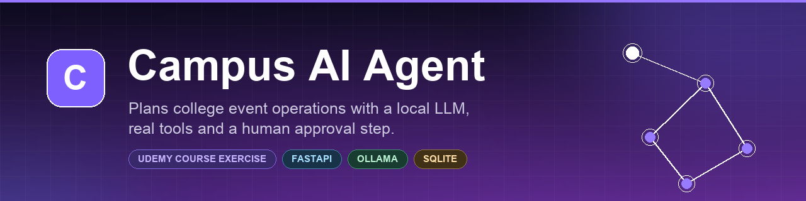

# Campus AI Agent




A Udemy course AI agent exercise project. The course builds a local-LLM agent
with tools and an approval step, I just pointed it at something I actually
needed: college event ops. So you type "organise a coding workshop for 60
students next friday", it builds a task plan, you approve it, and then it
creates the tasks for real. Planning runs on a local model via Ollama, no API
keys and nothing leaves the machine.

Flow is basically: plan -> you approve -> execute. Nothing runs before approve.

The plan the model has to return is strict JSON, roughly:

```json
{
  "goal": "run a coding workshop",
  "tasks": [
    { "id": "T1", "title": "book the hall", "tool": "create_task",
      "depends_on": [], "priority": "high",
      "inputs": { "title": "book the hall", "priority": "high" } }
  ]
}
```

so tasks can depend on each other and `agent.py` rejects unknown tools, bad
inputs and circular deps before anything is executed.

## files

- `main.py` – FastAPI app, routes + serving the dashboard
- `agent.py` – Ollama client, planner prompt, plan + input validation
- `executor.py` – runs the approved plan, respects `depends_on`
- `tools.py` – create_task / list_tasks / complete_task / get_weather
- `venue_routes.py` – venue booking API (sqlite)
- `venue_db.py` – sqlite helpers, standalone for now
- `static/` – dashboard (plain html/css/js, no build step)

## running

Needs python 3.9+ and Ollama installed and running.

```
python -m venv .venv && source .venv/bin/activate
pip install -r requirements.txt
ollama pull gemma3:4b
uvicorn main:app --reload
```

Then open localhost:8000. API docs are on /docs.

Config is by env var, nothing required:

- `OLLAMA_URL` – default `http://localhost:11434/api/chat`
- `OLLAMA_MODEL` – default `gemma3:4b`
- `CAMPUS_AI_AGENT_DB_PATH` – default `campus_ai_agent.db` next to the code
- `CAMPUS_AI_AGENT_ADMIN_TOKEN` – needed for the booking decision endpoint, without
  it that endpoint returns 503 on purpose

curl works too:

```
curl -X POST localhost:8000/api/plan -H 'Content-Type: application/json' \
  -d '{"request":"coding workshop for 60 students next friday"}'
```

Main endpoints: `POST /api/plan`, `POST /api/approve/{run_id}`,
`GET /api/runs/{run_id}`, `GET /venues`, `GET /venues/availability`,
`POST /bookings`. Rest is in /docs.

## notes / known issues

- runs are in memory, so they vanish when the server restarts. needs a db.
- `tests/test_tools.py` is still empty, only `test_agent.py` is written
  (`python test_agent.py`, it just prints PASS/FAIL)
- weather tool exists but the dashboard doesn't use it yet
- booking approval is guarded by a token but there's no real auth, it was for
  the demo
- the venue booking bit is my own addition, it's not part of the course exercise
- no screenshots in here yet, ran out of time

MIT
